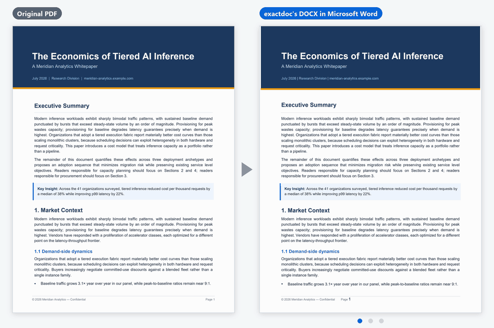
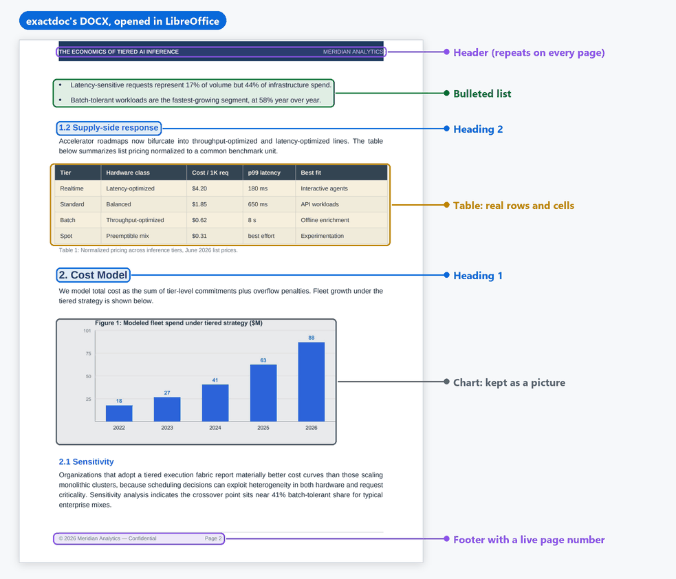
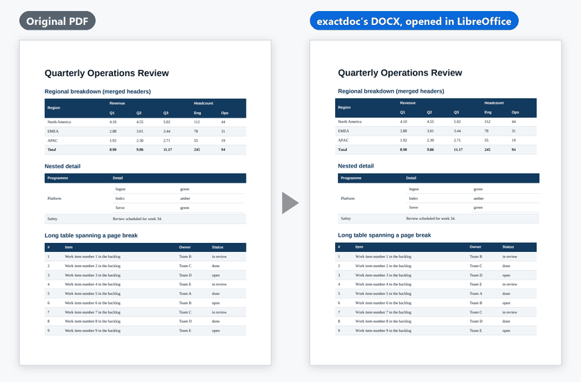
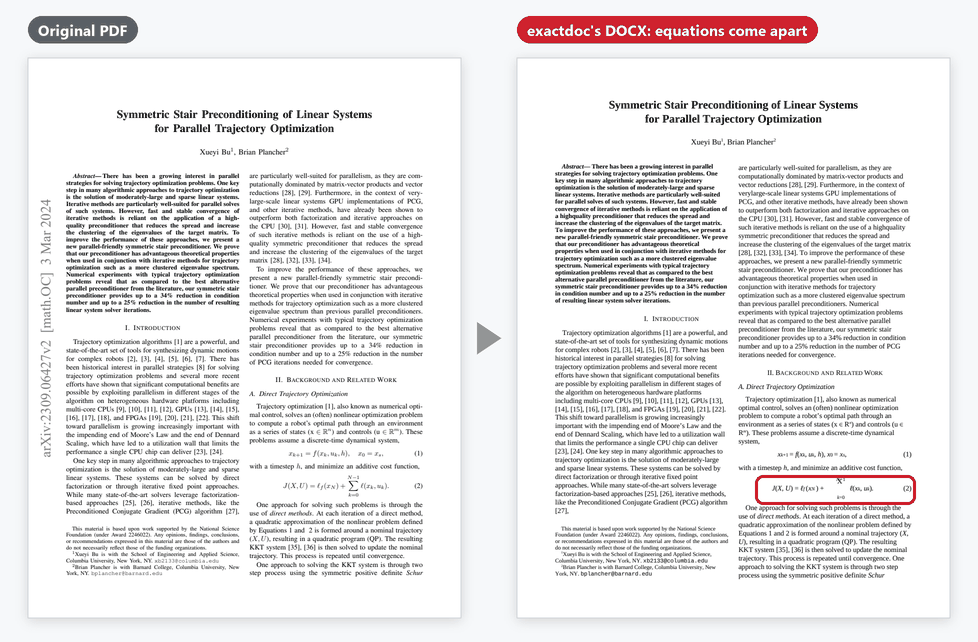

# exactdoc

**Turn a PDF into a Word document that looks like the original and that you
can actually edit.**

exactdoc writes a DOCX made of real headings, paragraphs, lists, tables,
footnotes and page headers, and lays them out so each page matches the PDF.
Its output is measured by opening it in Microsoft Word, LibreOffice and Google
Docs and comparing every page with the original. It runs entirely on your
machine: no telemetry, no account, and no network unless you ask for the
optional Google Docs measurement ([details](docs/install.md#what-talks-to-the-network)).



<sub>Page 1 of one of the project's test whitepapers, converted with the default
settings; Google Docs shows the DOCX made for it ([still image](docs/images/hero-readers.png),
[how it was made](docs/images/README.md)). Small differences remain: Google Docs
adds a thin white strip above the dark band, and the footer's page number sits
further left than in the PDF, set larger in Word and Google Docs.</sub>

<!-- release: at 0.3.0b1 this callout and the Install command are the only lines that change (docs/releasing.md, step 2). -->
> **Alpha (0.2.0a1).** The first beta, 0.3.0b1, is being prepared; until it is
> on PyPI, install from a clone of this repository.

## Install

You need Python 3.9 or newer.

<!-- release: becomes `pip install --pre exactdoc` and `exactdoc --version` -->
```bash
git clone https://github.com/ebt55/exactdoc && cd exactdoc && pip install .
exactdoc --version
```

Optional, and recommended: **[LibreOffice](https://www.libreoffice.org/download/)**
(free). When it is installed, exactdoc opens its own DOCX in it, compares each
page with the PDF and corrects page breaks and spacing. Without it, exactdoc
converts in one pass and says so. [docs/install.md](docs/install.md) covers the
fonts LibreOffice needs on Linux, how long the check takes, and the optional
extras.

## Quick start

```bash
exactdoc report.pdf                                    # writes report.docx next to it
exactdoc report.pdf --output-profile gdocs --refine 0  # a DOCX made for Google Docs
exactdoc --input-dir pdfs --out-dir docx --recursive   # a whole folder
```

```python
from exactdoc import convert
convert("report.pdf", "report.docx")                                  # with LibreOffice's check
convert("report.pdf", "report.docx", refine_rounds=0, oracle="none")  # without LibreOffice
```

exactdoc never replaces a file you did not name. The Google Docs option writes
the same document in a form Google Docs' importer reads correctly; it is still
made offline, and you upload it to Drive yourself. Every option, the Python API
and the exit codes are in [docs/usage.md](docs/usage.md).

## What you get

The DOCX is built from the same pieces you would use to write the document in
Word yourself, not from text boxes pinned to the page:



- **Headings** use Word's heading styles, so the navigation pane and Google
  Docs' outline work.
- **Paragraphs** flow and re-wrap when you edit them.
- **Lists** are real bulleted and numbered lists.
- **Tables** are real tables, with merged cells and rows that run over pages.
- **Headers and footers** repeat on every page, with live page numbers.
  **Footnotes** are real Word footnotes (plain text in the Google Docs output,
  because Docs moves real ones), and links still work.
- **Charts, logos and artwork** stay pictures, placed where the PDF has them.

## What works, and what does not yet

What exactdoc promises depends on the program that made the PDF. Documents
written as flowing text in **Word, Google Docs, LibreOffice or LaTeX** are
promised. Designed layouts are not, yet. Page counts below are from the final
measurement for the beta ([record](docs/evidence/final-set-2026-10-11.json)).

| Kind of PDF | Today |
|---|---|
| Reports, memos, letters, whitepapers, papers and résumés written in Word, Google Docs, LibreOffice or LaTeX | Works well |
| Tables, simple two-column pages, headers, footers, footnotes, links | Works well |
| Latin, Cyrillic and Greek text | Works well |
| Chinese, Japanese and Korean text | Partly: the text survives, but some runs become pictures |
| Arabic, Hebrew and Persian (right-to-left) | Partly: right-to-left paragraphs in reading order; pages can grow, and the Google Docs output is not yet right-to-left |
| Long documents opened in Google Docs | Mostly: some gain pages (IRS Publication 15: 62 pages for 59) |
| Designed reports and annual reports (InDesign, Affinity, QuarkXPress, Publisher) | Not yet: the text stays editable, but the layout does not hold |
| Multi-column booklets (IRS, GPO, Federal Register style) | Not yet: IRS Publication 501 grows from 31 pages to 45 in LibreOffice |
| Dense journal papers, equations | Not yet: equations come apart, and pages can be added |
| Slide decks, brochures, posters | Not yet |
| Scans without a text layer, fillable forms, over 250 pages | Refused with a clear message and exit code (no OCR is built in; `--max-pages` raises the cap) |

<table>
<tr>
<td width="50%"></td>
<td width="50%"></td>
</tr>
<tr>
<td><b>Works:</b> tables become real Word tables, merged cells included.</td>
<td><b>Not yet:</b> in a dense arXiv paper (CC BY 4.0) the text converts, but equations come apart.</td>
</tr>
</table>

To see which program made a PDF, open **File → Properties** in a PDF viewer and
read the Producer and Application fields, or run `exactdoc --diagnose your.pdf`,
which prints them without any of the document's text. The full list, with
numbers, is in [docs/deep-dive/limitations.md](docs/deep-dive/limitations.md);
more side-by-side pictures are in [docs/examples.md](docs/examples.md).

## How we know

Measured, not eyeballed. Every change must pass 16 frozen test documents,
gated on every push in CI inside the pinned measurement image, and
each milestone converts 95 frozen PDFs (those 16 and 79 more, most of them
public real-world documents), opens every DOCX in LibreOffice, Microsoft Word
and Google Docs, and compares it with the PDF page by page. In the final
measurement for the beta ([record](docs/evidence/final-set-2026-10-11.json),
[scorecard](docs/evidence/beta-readiness-2026-10-11.json)):

- all 41 promised documents of up to 20 pages kept exactly their page count in
  all three;
- of the 21 promised documents over 20 pages, all 21 in LibreOffice and Word,
  and 18 in Google Docs, kept their page count within 2% (or one page) with at
  least 85% of their words on the right page;
- across everything, including the kinds marked "Not yet", Word opened all 90
  DOCX files without asking to repair one, and in Google Docs
  66 of the 90 compared came back with exactly the right number of pages.
  The other five are PDFs exactdoc refuses on purpose.

These are the documents exactdoc was developed against, so they show how well
it does on PDFs it has seen. How the measurement works:
[docs/deep-dive/measured-state.md](docs/deep-dive/measured-state.md).

### Tested on documents it has never seen

Coming with 0.3.0b1: a sealed set of 32 public PDFs that were never used in
development is converted once, on the release candidate, and its results go
here beside the numbers above.

## Fonts

The DOCX names only fonts that a standard Windows 10 or 11 computer with
Microsoft Office has, with one exception: Chinese, Japanese, Korean, Arabic,
Hebrew, Persian and Thai text keeps the PDF's own font name, so a reader who
has that font sees it and one who does not gets Word's default for the script.
The fonts the test documents name this way are `Noto Sans CJK JP`,
`IPAPGothic`, `WenQuanYi Zen Hei`, `DFKai-SB`, `DejaVu Sans`,
`Noto Naskh Arabic`, `David`, `Narkisim`, `BNazanin` and `Thonburi`.

## Contributing

PRs welcome. See [CONTRIBUTING.md](CONTRIBUTING.md) for the one-command quality
check every PR runs. If a conversion goes wrong,
[report it](https://github.com/ebt55/exactdoc/issues/new?template=bad-conversion.yml)
with the output of `exactdoc --diagnose your.pdf` instead of the PDF itself.

## Learn more

| | |
|---|---|
| [docs/install.md](docs/install.md) | LibreOffice and its fonts, timing, the optional extras, what talks to the network |
| [docs/usage.md](docs/usage.md) | Every option, the Python API, batch mode, exit codes |
| [docs/deep-dive/limitations.md](docs/deep-dive/limitations.md) | What does not work yet, with numbers |
| [docs/examples.md](docs/examples.md) | More pages side by side, the good and the bad |
| [docs/deep-dive/measured-state.md](docs/deep-dive/measured-state.md) | How the numbers are measured |
| [CHANGELOG.md](CHANGELOG.md) | What changed, release by release |
| [SECURITY.md](SECURITY.md) | Reporting a security problem privately |
| [docs/README.md](docs/README.md) | Index of every deeper document |

## Licence

exactdoc is [Apache-2.0](LICENSE). A default install pulls in no copyleft code.
The optional `mupdf` extra (`pip install "exactdoc[mupdf]"`) adds PyMuPDF, which is
AGPL-3.0; it is only a reference for measurements and does not change the output.
Details: [docs/deep-dive/licensing.md](docs/deep-dive/licensing.md) and
[docs/license-audit.md](docs/license-audit.md).
