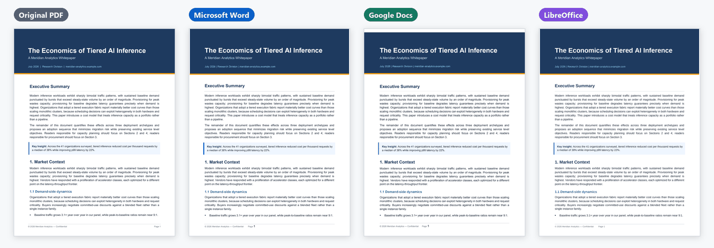
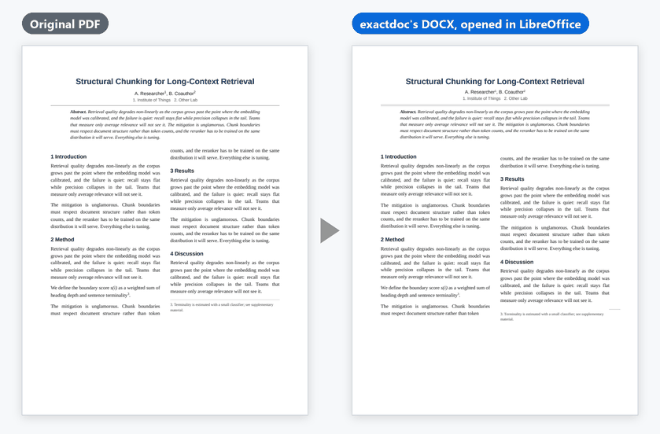
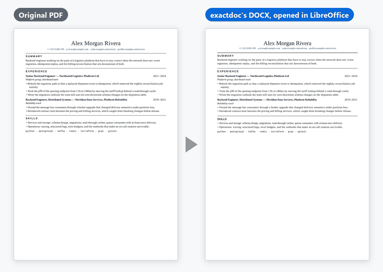
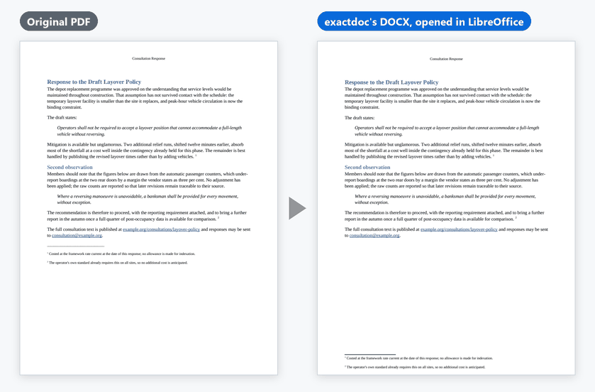
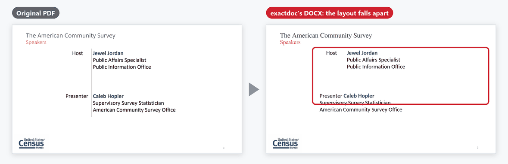
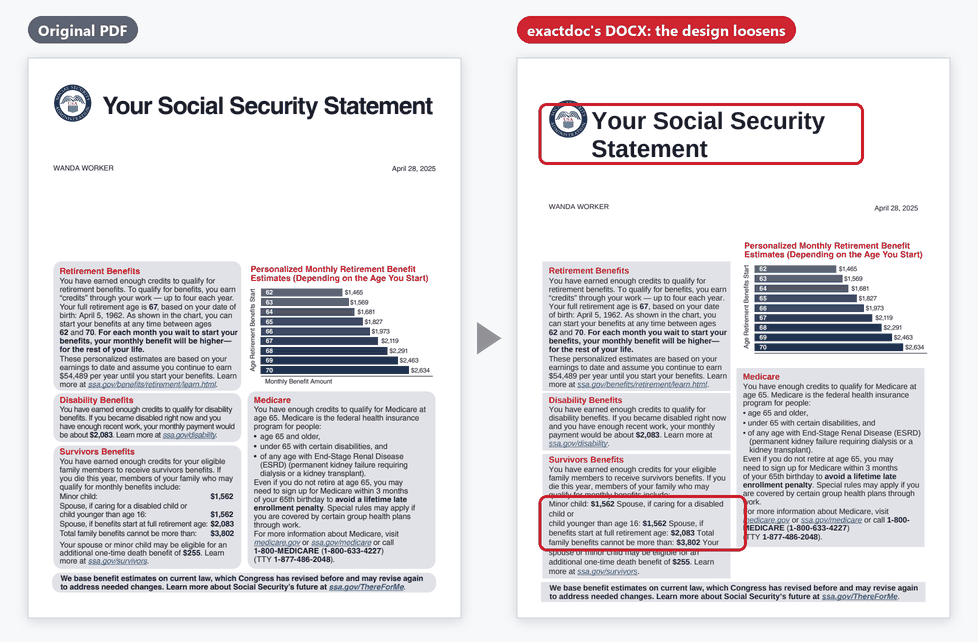

# Examples, side by side

Each picture puts a page of a PDF beside the same page of the DOCX exactdoc
made from it, converted with the default settings. The DOCX pages are
LibreOffice's renders from the final measurement of 11 October 2026, made in
the project's pinned test container; the top picture adds Microsoft Word's and
Google Docs' renders of the same document from that measurement. How each
picture was made is recorded in [images/README.md](images/README.md), and the
numbers quoted here are from
[the measurement record](evidence/final-set-2026-10-11.json).

## One document in three readers

The still of the README's animation. Google Docs adds a thin white strip above
the dark band (Docs adds about 14.6 points above a page-one band, and the DOCX
cannot remove it) and draws the quote box with a full border; in all three the
footer's page number sits further left than in the PDF.

## Works well

All four are test documents this project generated (Apache-2.0).

<table>
<tr>
<td width="50%"></td>
<td width="50%"></td>
</tr>
<tr>
<td><b>Tables</b> become real Word tables with merged cells. A table-within-a-table is rebuilt as one table with merged cells.</td>
<td><b>Two-column pages</b> keep their columns as a real two-column section.</td>
</tr>
<tr>
<td></td>
<td></td>
</tr>
<tr>
<td><b>Résumés</b>: role and date on one line, rules under section headings, bullet lists.</td>
<td><b>Quotes, links and footnotes.</b> Footnotes become real Word footnotes, so they move to the foot of the page.</td>
</tr>
</table>

## Not yet

Public documents outside what exactdoc promises today. The red outlines mark
what goes wrong.

**Slide decks.** Slide 3 of a US Census Bureau webinar deck (public domain).
Slide layouts fall apart. The 40-slide deck keeps its 40 pages in LibreOffice
and Word, but about three quarters of its text sits in text boxes, and Google
Docs makes 54 pages of it.

**Dense journal papers with equations.** Bu and Plancher, arXiv:2309.06427
(CC BY 4.0). The flowing text converts, but equations come apart. The 8-page
paper becomes 9 pages in LibreOffice and Word and 10 in Google Docs, with 70%
of its words on the right page in LibreOffice.

**Heavily designed layouts.** A sample Social Security Statement (US
government, public domain; "Wanda Worker" is SSA's fictional sample). The grey
panels are shaded text and 89% of the words are editable, but the design
loosens: the title wraps, and rows that were laid out as a table run together.
It keeps its 2 pages in LibreOffice and Word; Google Docs makes 4 of them, with
only 39% of the words on the right page.

The full list of limits, with numbers, is in
[deep-dive/limitations.md](deep-dive/limitations.md).
